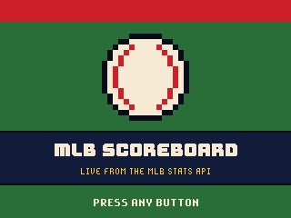
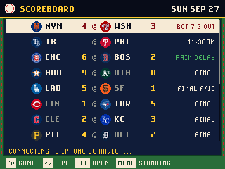
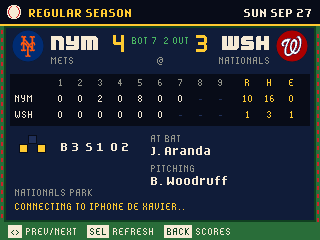
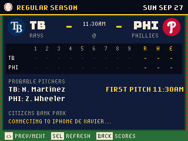
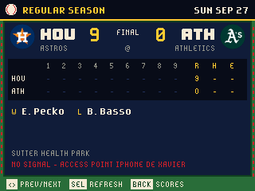
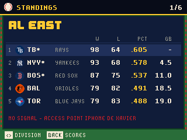

# MLB Scoreboard for the GitHub Universe 2026 badge

An 8-bit MLB scoreboard app for the GitHub Universe 2026 badge: live scores,
inning-by-inning linescores and division standings from the
[MLB Stats API](https://statsapi.mlb.com), which needs no key.

| Splash | Scoreboard | Live game |
| --- | --- | --- |
|  |  |  |

| Before first pitch | Final | Standings |
| --- | --- | --- |
|  |  |  |

Every team shows its logo on the scoreboard, in the game header and in the
standings.

## Install

1. Put the badge in USB Disk Mode (open the Mass Storage app, or double-tap
   RESET) so the `BADGER` volume appears.
2. Copy the `apps/mlb` folder into `BADGER/apps/` (so you end up with
   `BADGER/apps/mlb/__init__.py`).
3. If your badge still runs the stock event menu, its tiles ignore `icon.png`.
   The [hyb26 skill](https://github.com/badger/home/tree/main/.github/skills/hyb26-skill)
   ships `patch_menu_icons.py`, which adds that support (with a backup).
   Without it the app still works, it just shows the default tile icon.
4. Eject the volume. The badge restarts into the menu with an MLB tile.

Scores need Wi-Fi: set `WIFI_SSID` and `WIFI_PASSWORD` in the badge's
`secrets.py` (the Settings app does this). Game times use `TIMEZONE` from the
same file, the badge's offset from UTC in hours. The last slate and standings
are kept on the badge, so it can show its most recent scores offline.

## Controls

| Button | Scoreboard | Game | Standings |
| --- | --- | --- | --- |
| Up / Down | Pick a game | - | - |
| Left / Right | Previous / next day | Previous / next game | Previous / next division |
| Select | Open the game | Fetch again now | - |
| Menu | Standings | - | Back to scores |
| Back | Back to today | Back to scores | Back to scores |

The slate refreshes every 30 seconds while any game is live and every five
minutes otherwise; an open live game refreshes every 20 seconds.

## How it works

- `apps/mlb/__init__.py` is the app: the scoreboard, game and standings
  screens, the refresh timers and the on-badge cache.
- `apps/mlb/mlbapi.py` builds the API URLs and distils the replies. The API's
  `fields` parameter prunes them, so a full 15-game day with linescores,
  probable pitchers and decisions is about 12KB and a linescore about 2KB.
  It also carries the date and time helpers, since the badge has no timezone
  database, and strips accents from names the badge fonts cannot draw.
- `apps/mlb/assets/teams.json` maps the 30 team ids to abbreviations,
  nicknames and divisions, built by `tools/build_teams.py`.
- `apps/mlb/assets/logos` and `logos16` hold each team's spot logo from MLB's
  CDN at 32 and 16 pixels, fetched by `tools/build_logos.py`. The scoreboard
  blits the 16px copies 1:1 because scaling sixteen logos a frame cost 3ms each.

## Tools

- `tools/build_teams.py` regenerates the team table.
- `tools/build_logos.py` refetches the team logos (needs ImageMagick).
- `tools/badge_harness.py` drives the app's frame loop on a real badge over
  `mpremote run`, simulating button presses against fixture replies and saving
  run-length encoded screenshots to `/state/shots`; `tools/rle2png.py`
  converts them.

Data comes from the MLB Stats API and the logos from MLB's CDN. MLB, team
names and logos are trademarks of their owners; this is a fan project.
